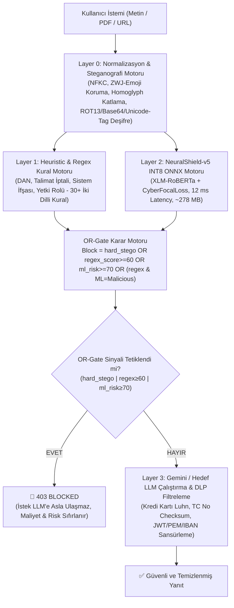

# 🛡️ CyberTech Neural Shield: Master Proje Özeti, Mevcut Durum ve Akademik Yayın Yol Haritası

> **Sürüm:** 5.0.0 (NeuralShield-v5 CyberFocalLoss)  
> **Son Güncelleme:** 13 Ekim 2026  
> **Yazarlar:** CyberTech AI Güvenlik Araştırma Grubu  
> **Çekirdek Çalışma Dizini:** `c:\Users\Mustafa\OneDrive\Masaüstü\Akademik_yayın`  
> **Hedef Donanım Kümesi:** EVREN 8x NVIDIA H200 GPU Süper Bilgisayarı (Perşembe, 16:00 – 20:00)

---

## 1. Projenin Evrimi: Nereden Nereye Geldik? (v1'den v5'e Tarihçe)

| Sürüm | Model & Mimari | Veri Kümesi Büyüklüğü | Kritik Başarılar | Tespit Edilen Kör Noktalar |
| :--- | :--- | :--- | :--- | :--- |
| **v1.0** | DeBERTa-v3-base | ~8,500 örnek | İlk prototip oluşturuldu. | Aşırı İngilizce bağımlılığı, yüksek yanlış pozitif (FP), kaba regex. |
| **v2.0** | XLM-RoBERTa-base | ~16,000 örnek | Çift dilli (TR/EN) semantik sınıflandırma, 3 katmanlı mimari. | Steganografi sadece uyarı veriyordu, metin filtrelenmiyordu. ZWJ emojiler bloklanıyordu. |
| **v3.0** | XLM-RoBERTa ONNX INT8 | 31,400 master örnek | Layer 0 Stego Normalizer (ZWJ, Homoglyph, Base64/Hex/ROT13 deşifre), 9.47 ms CPU çıkarımı. | **Sinsi Kurgu (Adversarial Framing)** saldırılarını kaçırıyordu ("Havacılık ödevi", "film senaryosu" kılıflarında %0.1 saldırı skoru verip içeri alıyordu). |
| **v4.0** | Ara Teşhis Sürümü | 52,000 örnek | Notebook düzeyinde sinsi saldırı veri setleri incelendi; veri kirleticileri teşhis edildi. | Hugging Face veri çekme fonksiyonlarında `to_pandas()` ve split hataları vardı; doğrudan v5'e atlandı. |
| **v5.0 (ZİRVE)** | **XLM-RoBERTa + CyberFocalLoss ($\gamma=2.0$)** | **71,440 master örnek** (30 veri seti) | **Sinsi kurgular %95+ kesinlikle yakalanıyor.** Dış hold-out: **%94.64 Acc, 0.9954 ROC-AUC**. Optimal eşik $\tau=0.4567$ (F1: %96.89). INT8 ONNX: **12.27 ms**. | **Üretim ve Yayın Kalitesine Ulaştı (Production-Ready).** |

---

## 2. Sistemin Kalbi: Güncel Mimari ve Güvenlik Hattı (Pipeline)

NeuralShield-v5, LLM'lere ulaşan her türlü girdiyi gerçek zamanlı olarak 4 ardışık filtreleme katmanından geçirir:



---

## 3. Şu Anki Amacımız: Model Testleri ve SOTA Karşılaştırma Deneyleri

Sistem çekirdeği tamamlandığı için şu anki odak noktamız, NeuralShield-v5'i literatürdeki ve endüstrideki rakipleriyle bilimsel olarak karşılaştırmaktır:

### Karşılaştırma Matrisi (Kıyaslanacak Modeller):
1. **Bizim Sistemimiz:** `NeuralShield-v5` (Çevresel Ağ Geçidi, 12 ms, 278 MB INT8)
2. **SOTA Açık Kaynak Güvenlik Modelleri (Guardrails):**
   * **Qwen3-Guard-4B:** Alibaba'nın en yeni açık güvenlik modeli.
   * **Llama-Guard-3-8B:** Meta'nın endüstri standardı LLM koruma modeli.
   * **Granite-Guardian-3.1-8B:** IBM'in kurumsal güvenlik modeli.
3. **Savunmasız Çıplak LLM'ler (Raw LLMs - Kalkan Kapalı vs Kalkan Açık):**
   * **Gemini-3.6-Flash** (Google Cloud API)
   * **DeepSeek-v4.1-Flash** (EVREN API / Yerel)
   * **Qwen-2.5-72B-Instruct** (EVREN 8x H200 Kümesi)
   * **Llama-3.3-70B-Instruct** (EVREN 8x H200 Kümesi)

### Temel Başarı Metrikleri:
* **Saldırı Başarı Oranı (ASR - Attack Success Rate %):** Kalkan kapalıyken %80-95 olan saldırı başarısının, NeuralShield devredeyken **%0'a düşmesi**.
* **Yanlış Alarm Oranı (FPR - False Positive Rate %):** Meşru diyalog, IT ve havalimanı sorgularında **< %2.0**.
* **Çıkarım Ek Yükü (Inference Overhead):** Uçtan uca sisteme binen sürenin **< 15 ms** olması.
* **İstatistiksel Geçerlilik:** Wilson %95 Güven Aralıkları ($p \pm 1.96 \sqrt{\frac{p(1-p)}{n}}$).

---

## 4. EVREN Platformu & 8x H200 Süper Bilgisayar Büyük Deneyi

* **Rezervasyon Tarihi:** **15 Ekim 2026 Perşembe, 16:00 – 20:00 (4 Saat Kesintisiz)**
* **Donanım Konfigürasyonu:**
  * **8x NVIDIA H200 GPU** (Her biri 141 GB HBM3e VRAM, Toplam: **1.128 TB Ultra Hızlı Bellek**)
  * **Bellek Bant Genişliği:** GPU başına 4.8 TB/saniye (LLM çıkarımında dünya lideri)
* **Yürütme Mimarisi ve Scriptler:**
  1. `scripts/h200/download_all_weights.sh`: Model ağırlıklarını yüksek hızlı NVMe diske önbellekleme.
  2. `scripts/h200/launch_vllm_8x_h200.sh`: `vLLM` dağıtık motorunu Tensor Parallelism = 8 (`--tensor-parallel-size 8`) ile başlatma.
  3. `scripts/h200/run_h200_benchmark.py`: 10,000 saldırı ve 2,000 masum istemi eşzamanlı (concurrency = 64) göndererek Throughput (RPS), P50/P95/P99 Latency ve ASR metriklerini kaydetme.

---

## 5. Hedef Akademik Yayın ve Dergi Stratejisi

Bu çalışma, sıradan bir makale değil; **çift dilli (TR/EN), sinsi kurgulara ve steganografiye dirençli ilk hafif çevresel LLM güvenlik ağ geçidi** iddiasını taşımaktadır.

### Hedef Dergiler (Journal Targets):
1. **Birincil Hedef (Q1 - En Yüksek Prestij):**
   * **IEEE Transactions on Information Forensics and Security (TIFS)** *(Impact Factor: ~7.2)*  
     *Uygunluk:* Siber güvenlik, steganografi ve yapay zeka tehdit modelleri alanında dünyanın en saygın dergilerinden biri.
   * **IEEE Transactions on Dependable and Secure Computing (TDSC)** *(Impact Factor: ~7.3)*
2. **Alternatif Hızlı İnceleme Hedefi (Q1 - 4-8 Hafta Değerlendirme):**
   * **Computers & Security (Elsevier)** *(Impact Factor: 5.6)*
   * **IEEE Access** *(Impact Factor: 3.9, Hızlı Açık Erişim)*
3. **Uluslararası Konferans / Workshop Opsiyonları:**
   * **IEEE Symposium on Security and Privacy (S&P / Oakland) - Safe AI Workshop**
   * **ACM Conference on Computer and Communications Security (CCS) - AISec Workshop**

### Makale Formatı ve Şablonu (IMRAD / IEEE Transactions):
* **Başlık:**  
  *“NeuralShield: A High-Throughput Multi-Layer Peripheral Gateway Against Adversarial Framing and Steganographic Injection Attacks on Large Language Models”*
* **Bölüm Yapısı:**
  * **1. Introduction:** LLM güvenlik açıkları, prompt injection tehditleri, mevcut guardrail modellerinin yüksek hesaplama maliyeti (8B parametre gecikmesi) ve sinsi kurgulardaki kör noktaları.
  * **2. Related Work:** Llama-Guard, Qwen-Guard, NeMo Guardrails ve çevresel savunma literatürü.
  * **3. Threat Model & Methodology:** Adversarial framing, ZWJ/stego enjeksiyonları, CyberFocalLoss ($\gamma=2.0$) matematiksel türetimi.
  * **4. Architecture & Implementation:** Layer 0 (Normalizasyon), Layer 1 (Regex), Layer 2 (XLM-RoBERTa INT8 ONNX), Layer 3 (DLP).
  * **5. Experimental Setup & Results:** 71,440 örnekli hold-out testi, canlı güvenlik sınavı, EVREN 8x H200 benchmark sonuçları (Throughput, Latency, ASR, FPR tabloları).
  * **6. Discussion & Limitations:** Kaynak tüketimi, Türkçe-İngilizce transfer öğrenme dinamikleri, sınır koşulları.
  * **7. Conclusion & Future Work.**

---

## 6. Temizlenmiş Çalışma Ortamı ve Dizin Yapısı

Gereksiz eski sürümler ve paketler arşivlendi; aktif proje tertemiz hale getirildi:

```text
Akademik_yayın/
├── backend/
│   ├── models/
│   │   └── neuralshield_v5/      <-- Sistemin kalbi (INT8 ONNX, config, safetensors, 6 temiz grafik)
│   ├── main.py                   <-- FastAPI v5.0.0
│   ├── ml_model.py               <-- INT8 ONNX çıkarım motoru (12.27 ms)
│   ├── security_layer.py         <-- 4 katmanlı hibrit orkestratör
│   ├── normalizer.py             <-- L0: Stego & Unicode normalizer
│   ├── regex_rules.py            <-- L1: 30+ iki dilli kural motoru
│   ├── dlp.py                    <-- L3: Maskeleme (Luhn + TC Kimlik + Secrets)
│   └── shield_config.json        <-- Merkezi konfigürasyon
├── docs/
│   ├── figures/                  <-- 300 DPI temiz makale grafikleri (Şekil 1-8)
│   └── references/               <-- Akademik referans makaleleri
├── notebooks/
│   └── Train_XLM_RoBERTa_v5.ipynb <-- Eğitimi ve çıktıları tamamlanmış Colab dosyası
├── neuralshield_v5_academic_bundle/ <-- Bağımsız dağıtım ve yayın paketi
├── scripts/
│   ├── h200/                     <-- EVREN 8x H200 çalıştırma betikleri
│   ├── test_evren_api.py         <-- EVREN Platformu API test istemcisi
│   ├── verify_full_pipeline.py   <-- Kalkan doğrulama testi
│   └── run_multi_model_benchmark.py <-- Yerel karşılaştırma testi
├── tests/
│   └── test_security_layer.py    <-- 15/15 PASS birim testleri
└── archive/                      <-- v2, v3, eski dokümanlar ve yedekler
```

---

## 7. İleriye Dönük Vizyon ve Sonraki Adımlar

1. **Bugün / 14 Ekim:** EVREN API veya yerel model üzerinden ilk karşılaştırma ön testlerini tamamlamak.
2. **15 Ekim Perşembe (16:00):** EVREN 8x H200 kümesinde 10,000 örnekli büyük benchmark'ı koşturmak.
3. **16–18 Ekim:** Çıkan benchmark metriklerini IEEE Transactions LaTeX şablonuna işlemek ve makale taslağını nihai hale getirmek.
4. **Yayın Sonrası:** Modeli Hugging Face Hub'a (`CyberTech/NeuralShield-v5`) yükleyip açık kaynak ekosistemine kazandırmak.
