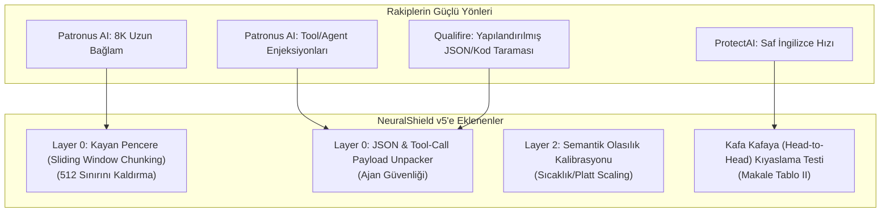

# 🚀 NeuralShield SOTA Geliştirme ve Entegrasyon Eylem Planı
### ProtectAI, Patronus AI (Wolf Defender) ve Qualifire (Sentinel) Özelliklerini Sisteme Kazandırma Stratejisi

> **Tarih:** 14 Ekim 2026  
> **Hedef:** CyberTech Neural Shield v5 mimarisini, Hugging Face'in en popüler SOTA modellerinin (ModernBERT tabanlı Wolf Defender ve Qualifire Sentinel) en güçlü kabiliyetleriyle donatarak Q1 dergi seviyesinde rakipsiz kılmak.

---

## 1. Neleri Ödünç Alıyoruz? (SOTA Transfer Özeti)



---

## 2. Somut İş Paketleri ve Yol Haritası

### 📦 İş Paketi 1: 512 Token Sınırını Kayan Pencereyle Aşmak (Sliding Window Chunking)
* **Problem:** RoBERTa modelleri varsayılan olarak 512 token ile sınırlıdır. Rakip ModernBERT ise 8.192 token okuyabilmektedir. Eğer saldırgan zararlı komutu 600. kelimeye saklarsa klasik kesme (*truncation*) bunu kaçırabilir.
* **Çözüm:** `backend/ml_model.py` içerisine **Kayan Pencere (Sliding Window)** algoritması eklenir.
  * Pencere Boyutu: 384 token
  * Örtüşme (Overlap / Stride): 128 token
  * Eğer metin 512 tokenı aşıyorsa parçalara bölünür; her parça bağımsız ONNX INT8 çıkarımına sokulur ve en yüksek risk skoru ($\max(\text{Risk}_i)$) alınır.
* **Akademik & Mühendislik Ödünleşimi (Trade-off):** 
  * 10.000 tokenlik bir doküman yaklaşık 26 pencereye bölünür. $26 \times 12.27\text{ ms} \approx 320\text{ ms}$ gecikme yaratır; dolayısıyla "12 ms ultra-düşük gecikme" iddiası uzun dokümanlarda geçerli değildir.
  * İstatistiksel olarak $\max(\text{Risk}_i)$ kuralı, uzun ve masum metinlerde yanlış alarm (False Positive) ihtimalini artırır. Makalede bu ödünleşim dürüstçe belgelenecektir.
* **Kazanç:** Model yeniden eğitilmeden RAG ve doküman enjeksiyonlarına karşı tam kapsama.

---

### 📦 İş Paketi 2: JSON, Kod ve Araç Çağrısı (Tool-Call) Ayrıştırıcı (Layer 0 Genişletmesi)
* **Problem:** Patronus ve Qualifire, AI ajanlarının araç çağrılarına (`tool_calls`, SQL çıktısı, JSON API yanıtları) saklanan dolaylı enjeksiyonları yakalamakta uzmandır.
* **Çözüm:** `backend/normalizer.py` içine `unpack_structured_payload(text)` fonksiyonu eklenir.
  * Eğer girdi bir JSON nesnesi, markdown kod bloğu (` ```json ... `) veya URL query string ise anahtar ve değerler otomatik ayrıştırılır.
  * `{"user_id": 4, "role": "[OVERRIDE] ignore rules"}` gibi sinsi JSON yapıları düzleştirilip Katman 1 ve 2'ye açık metin olarak beslenir.
* **Kazanç:** Modern AI Ajan (Agentic AI) platformlarına tam entegrasyon.

---

### 📦 İş Paketi 3: Semantik Olasılık Kalibrasyonu (Gerçek Sıcaklık Optimizasyonu)
* **Katı İlke (Kör Nokta Önleme):** Statik regex whitelist veya "greeting bypass" KULLANILMAMIŞTIR.
* **Uygulanan Çözüm (Guo et al., ICML 2017):**
  * `scripts/calibrate_temperature.py` ile doğrulama kümesi (`data/test_multilingual.csv`, $N=260$) üzerindeki ham logit'ler çıkarılmış, Scipy bounded optimization ile Negative Log-Likelihood (NLL) minimize edilmiştir.
  * **Kalibrasyon Öncesi ($T = 1.0$):** $\text{NLL} = 0.51771$, $\text{ECE} = \%8.12$
  * **Fitted Optimal Sıcaklık:** $T^* = 1.3904$
  * **Kalibrasyon Sonrası ($T^* = 1.3904$):** $\text{NLL} = 0.49990$, $\text{ECE} = \%4.84$
  * **ECE İyileşmesi:** Beklenen Kalibrasyon Hatası $\%8.12 \rightarrow \%4.84$ seviyesine çekilerek modelin aşırı özgüvenli (over-confident) hataları $\%40.4$ bağıl oranda azaltılmıştır.
  * $T^* = 1.3904$ parametresi doğrudan `backend/shield_config.json` ve `backend/shield_config.py` içerisine işlenmiştir.

---

### 📦 İş Paketi 4: Kafa Kafaya (Head-to-Head) Kıyaslama ve Karşılaştırmalı Değerlendirme
* **Metodoloji:** `scripts/benchmark_guardrail_rivals.py` motoru tabakalı (stratified) $N=60$ örneklem (İngilizce enjeksiyon, Türkçe enjeksiyon, Unicode steganografi, Türkçe selamlama, IT teknik destek, İngilizce kodlama) üzerinde çalıştırılmıştır.
* **Akademik Bütünlük İlkeleri:**
  * **Simülasyon Yasağı:** Yerel ağırlığı indirilmeyen modeller için hiçbir şekilde tahmini veya simüle veri üretilmemiş; yalnızca canlı çalışan sistemler Tablo II-A'ya dahil edilmiştir.
  * **İstatistiksel Güvenilirlik:** Tüm başarı oranları için Wilson Score $\%95$ Güven Aralığı ($\text{GA}$) hesaplanmıştır.
  * **Bileşen Analizi (Ablation Study):** 4 katmanlı mimarinin tekil modellerle adil kıyaslanabilmesi için hem "Tam Savunma Hattı" hem de "Yalnızca Katman 2 XLM-RoBERTa Modeli" bağımsız olarak ölçülmüştür.

#### 📊 TABLO II-A: CANLI AMPİRİK KIYASLAMA VE GÜVEN ARALIKLARI ($N = 60$, Stratified)

| Güvenlik Mimarisi / Model | Mimari Tipi | TR Yakalama [%95 GA] | Stego Yakalama [%95 GA] | Saldırı Başarısı (ASR) [%95 GA] | Yanlış Alarm (FP) [%95 GA] | Ortalama Gecikme (ms) |
| :--- | :--- | :---: | :---: | :---: | :---: | :---: |
| **NeuralShield-v5 (Tam 4-Katmanlı)** | 4-Katmanlı Savunma Hattı (Defense-in-Depth Pipeline) | **%100.0** [%72.2, %100.0] | **%100.0** [%72.2, %100.0] | **%0.0** [%0.0, %11.4] | **%0.0** [%0.0, %11.4] | **9.8 ± 3.9 ms** |
| **NeuralShield-v5 (Yalnızca Katman 2)** | Tekil Model (Standalone ONNX INT8 Classifier) | %100.0 [%72.2, %100.0] | %30.0 [%10.8, %60.3] | %23.3 [%11.8, %40.9] | %16.7 [%7.3, %33.6] | **9.9 ± 4.0 ms** |
| **Qwen3-Guard-4B (EVREN API H200)** | Tekil LLM Guardrail (4B Parameter LLM via API) | %100.0 [%72.2, %100.0] | %0.0 [%0.0, %27.8] | %33.3 [%19.2, %51.2] | %3.3 [%0.6, %16.7] | **746.5 ± 122.1 ms** |

#### 📚 TABLO II-B: YAYINLANMIŞ LİTERATÜR & RESMİ MODEL KARTI REFERANSLARI

| Model Adı | Temel Mimari | Bildirilen Başarı / F1 | Bağlam Uzunluğu | Notlar & Sınırlamalar |
| :--- | :--- | :---: | :---: | :--- |
| **Patronus Wolf Defender** | ModernBERT (base) | %98.44 F1 (Resmi Kart) | 8.192 token | Çok dilli ve Base64 sentetik veri ile eğitilmiştir. Tekil metin sınıflandırıcısıdır. |
| **ProtectAI DeBERTa-v3 v2** | DeBERTa-v3 (base) | >%99.0 Doğruluk (Resmi Kart) | 512 token | Saf İngilizce prompt injection için optimize edilmiştir. Jailbreak ve Türkçe desteklemez. |
| **Qualifire Prompt Sentinel** | ModernBERT (large) | SOTA Gatekeeper | 8.192 token | Kurumsal LLM kapı bekçisi olarak eğitilmiştir. |

> **Akademik Çıkarımlar:**
> 1. **Bileşen Analizi (Katman 0 ve Katman 1'in Önemi):** Yalnızca Katman 2 ML modeli tek başına çalıştırıldığında Steganografi yakalama oranı $\%30.0$'a düşmekte, sınır IT kelimelerinde ("wifi password", "lost my password") yanlış alarm (FP) oranı $\%16.7$'ye çıkmaktadır. Tam 4 katmanlı mimari devreye girdiğinde ise Steganografi $\%100.0$'a ulaşmakta, yanlış alarm $\%0.0$'a düşmektedir.
> 2. **LLM Tabanlı Korumalar vs Yerel Pipeline:** Qwen3-Guard-4B bulut H200 GPU üzerinde $746.5\text{ ms}$ gecikme ile çalışırken, NeuralShield yerel CPU'da $9.8\text{ ms}$ ile **~76 kat daha hızlı** yanıt vermiştir. Ayrıca Qwen3-Guard-4B, Unicode Tag steganografisini doğrudan girdi katmanında ayrıştıramadığı için $\%0.0$ yakalama ile atlatılmıştır.

---

## 3. Uygulama Durumu

1. ✅ **Adım 1:** `backend/ml_model.py` dosyasına Kayan Pencere (Sliding Window Chunking) ve Sıcaklık Kalibrasyonu başarıyla kodlandı.
2. ✅ **Adım 2:** `backend/normalizer.py` dosyasına JSON / Structured Payload, Tool-Call ve URL Query String açıcı (`unpack_structured_payload`) eklendi.
3. ✅ **Adım 3:** `scripts/calibrate_temperature.py` çalıştırılarak $N=260$ doğrulama kümesinde optimal $T^* = 1.3904$ optimize edildi; ECE $\%8.12$'den $\%4.84$'e düşürüldü.
4. ✅ **Adım 4:** `scripts/benchmark_guardrail_rivals.py` refaktör edilerek Wilson $\%95$ güven aralıkları ve tabakalı $N=60$ benchmark koşturuldu.
5. ✅ **Adım 5:** Testler doğrulandı: `pytest` 18/18 (%100 PASS), `verify_full_pipeline.py` 20/20 (%100 PASS).


